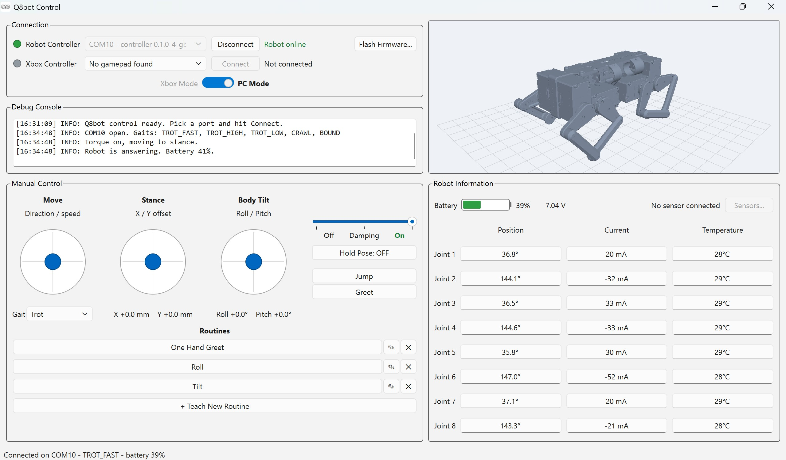

# Q8botOne Python

Python library and desktop app for **Q8botOne**, a quadruped robot with no physical wires that fits in the palm of your hand. Currently on sale at [**Crowd Supply**](https://www.crowdsupply.com/zerowire-robotics/q8botone).

> **Preliminary release.** This code is shared early so backers can see where
> it stands. It will be updated constantly throughout the campaign and before
> delivery, so please expect things to change.

## What's here

- `q8bot/` - the Python library, for driving the robot from your own scripts
- `q8bot/ui/` - the desktop app, built on the library
- `example.py` - a guided tour of the library on your robot

## Installing

So far this has been tested on Windows.

1. **Install Python 3.13** from [python.org](https://www.python.org/downloads/) - later Python releases may not be 100% compatible.

2. **Download this repository** - with git:

   ```
   git clone https://github.com/ZeroWireRobotics/q8botone-python
   cd q8botone-python
   ```

   or by using the **Download ZIP** option on GitHub, then unzip it
   (the folder is then called `q8botone-python-main`).

3. **Install the app and library.** In a terminal, in that folder, run the
   commands below. On Windows, use **Command Prompt**: an easy way is to open
   the folder in File Explorer, type `cmd` in the address bar and press
   Enter.

   Windows:

   ```
   py -3.13 -m venv venv
   venv\Scripts\activate
   pip install -e ".[gui]"
   ```

   macOS / Linux:

   ```
   python3.13 -m venv venv
   source venv/bin/activate
   pip install -e ".[gui]"
   ```

   The first line makes a virtual environment: a private Python setup for
   this project, so nothing clashes with your other Python programs. The
   second line switches to it - do that again each time you open a new
   terminal. The last line downloads what the app needs, which takes a few
   minutes.

Only want the Python library, without the app? `pip install -e .` installs
just that, and works with any Python from 3.9.

## Desktop app



1. Switch on the robot and the handheld controller, and check that their
   lights are solid blue (paired). Plug the controller into your computer
   with a USB cable.
2. Start the app:

   ```
   q8bot-gui
   ```

3. Under **Connection**, the app finds the controller by itself (for example
   **COM10 - controller 0.1.0**). Have the robot on the floor, then click
   **Connect** - the motors turn on and the robot stands up. **Robot online**
   means it's answering.
4. Under **Manual Control**:
   - Drag the dot in **Move** to walk - further for faster, let go to stop.
     **Gait** picks the walking style.
   - **Stance** and **Body Tilt** shift and lean the body while standing.
   - **Off / Damping / On** sets the motors.
   - **Jump**, **Greet** and the **Routines** play moves.
     **+ Teach New Routine** records your own.
5. **Robot Information** shows the battery and each joint's position,
   current and temperature. **Sensors...** shows the sensors on the robot's
   Qwiic port.
6. Click **Disconnect**, or close the app, when you're done.

While the app is connected, the controller only relays the app's commands -
turn it off and on to use its own buttons and joystick again. You can also
drive from the app with an Xbox controller (**Xbox Controller**, then
**Connect**), and **Flash Firmware...** updates the robot and controller.

## Python API

Plug the handheld controller into your computer with a USB cable, switch the
robot on, and start Python (`python`, in the same terminal as above). Your
computer talks to the controller, and the controller passes everything on to
the robot wirelessly.

### Connect

```python
from q8bot import Q8Bot

bot = Q8Bot.connect()
```

`connect()` finds the controller by itself and tells you whether the robot
answered:

```
INFO: Connected to the controller on COM10 - the robot is answering (battery 87%)
```

### Turn the motors on

```python
bot.set_torque(True)     # motors on - the robot stands up
```

`bot.set_torque(False)` turns them off again, and the legs go limp.

### Walk

```python
bot.move(0.5)            # walk forward
bot.move(-0.5)           # walk backward
bot.move(0.5, 0.3)       # walk forward, turning left
bot.move(0, 0.5)         # turn on the spot
bot.move(0, 0)           # stop
```

`move()` takes two numbers: the first is **forward** (negative goes
backward), the second is **turn** (positive turns left, negative right). Each
goes from -1 to 1. In the default gait, numbers further from 0 walk faster.
The robot keeps walking until you give it a new command.

### Switch gaits

```python
bot.set_gait('CRAWL')    # the robot stops and gets into the new stance
bot.move(0.5)            # walk on in the new gait
```

The gaits are `TROT_FAST` (the default), `TROT_HIGH`, `TROT_LOW`, `CRAWL`
and `BOUND`.

### Read the battery and sensors

```python
import time

bot.ping()               # True if the robot answers
bot.battery_percent      # the battery level, e.g. 87

bot.sensor_hz = 10       # read the sensors on the Qwiic port 10 times a second
time.sleep(0.5)
bot.sensors              # the latest readings from every sensor attached
```

The `readings` part of [`example.py`](example.py) prints each one with its name and unit.

### Finish

```python
bot.close()              # stop, motors off, and disconnect
```

If you quit Python without calling `close()`, it does the same for you.

### More

For everything else - posing the body, routines, built-in moves like jump
and greet, joint readings - run the guided tour. It walks, turns and jumps,
so give the robot some clear floor:

```
python example.py              # the whole tour
python example.py walk pose    # only the parts you name
```

Read [`example.py`](example.py) alongside it to see each command. Every command is
described in [`q8bot/robot.py`](q8bot/robot.py).

## Questions and feedback

If you have any questions, please open an [issue](https://github.com/ZeroWireRobotics/q8botone-python/issues) here on GitHub, or email
[yufeng.wu0902@gmail.com](mailto:yufeng.wu0902@gmail.com).

## License

MIT - see [LICENSE](LICENSE).
